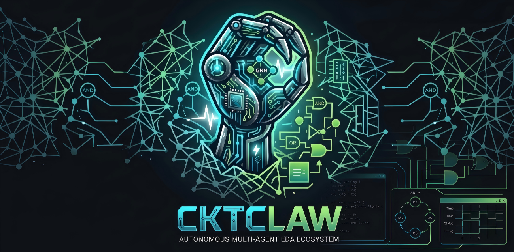
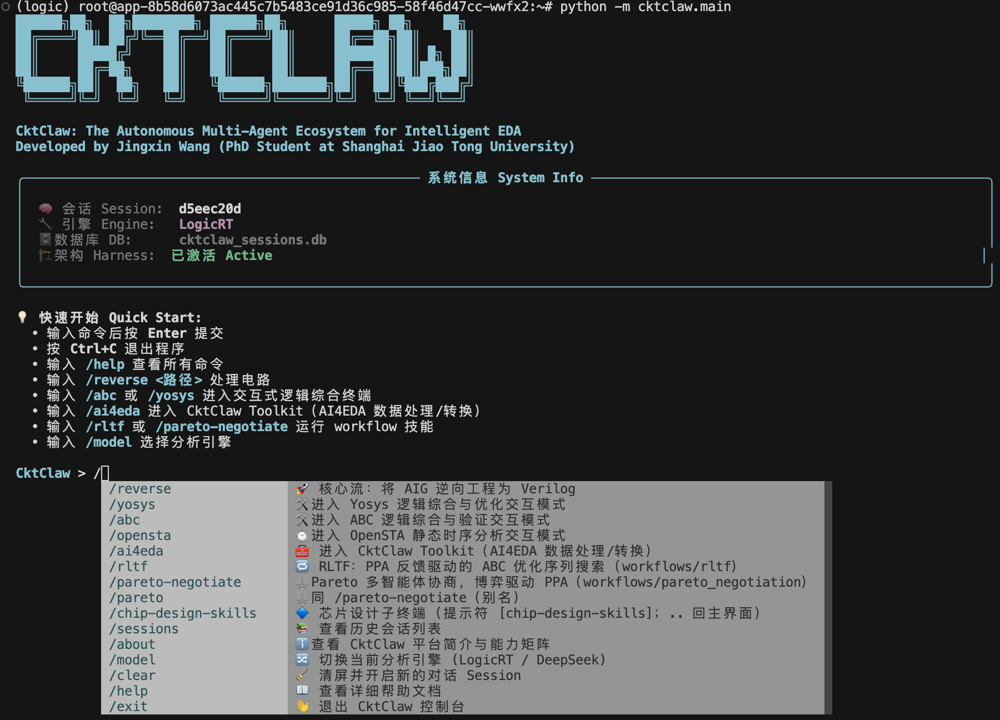
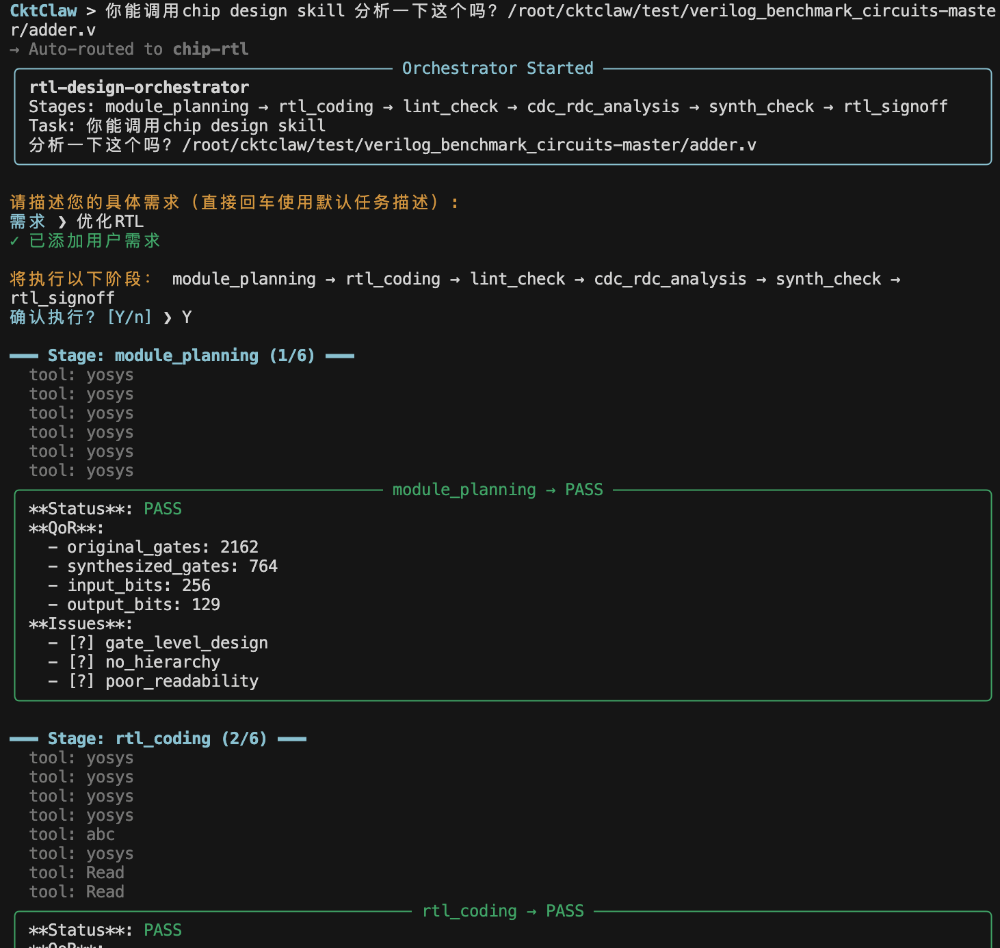
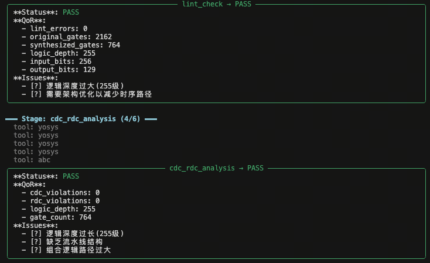
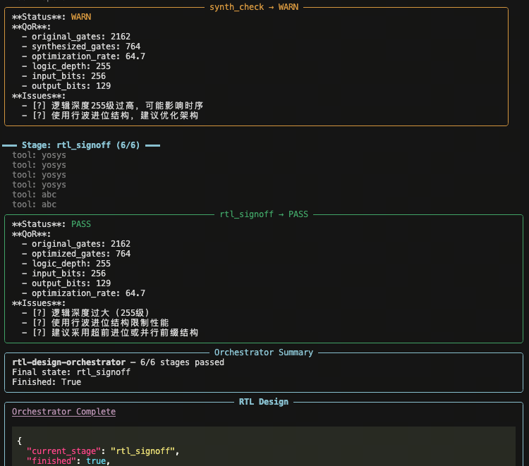
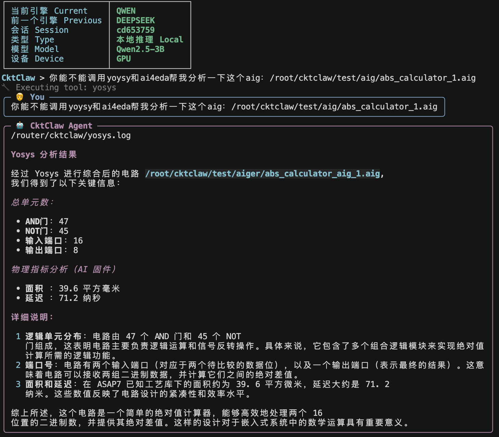

<div align="center">



# CktClaw

**面向智能 EDA 的多智能体自主生态 · The Autonomous Multi-Agent Ecosystem for Intelligent EDA**

[AlexWang](https://github.com/959AI994) · PhD Student · Shanghai Jiao Tong University · ACE Lab

[](https://www.python.org/downloads/)
[](LICENSE)
[](tests/)

**中文** | [English](README.md)

</div>

---

## 🎯 CktClaw

CktClaw 是一个面向芯片设计的**多智能体 AI 终端**。你只需用自然语言描述任务，CktClaw 自动识别设计领域、编排 EDA 工具、驱动多阶段流程，并给出完整的分析结果。

**核心亮点：**

- **自然语言驱动芯片设计** — 输入"帮我综合这个 adder，目标最小面积"，自动进入 synthesis orchestrator，逐阶段执行 constraint → compile → QC → sign-off
- **14 个芯片设计领域全覆盖** — Architecture / RTL / Verification / Formal / Synthesis / DFT / STA / HLS / Physical Design / SoC / Compiler / Firmware / FPGA / Infrastructure
- **20+ EDA 工具自动检测** — 启动时扫描 Yosys、Verilator、OpenSTA、NextPNR 等工具，自动配置 MCP server
- **智能上下文管理** — 四层记忆架构 + 自动压缩，长对话不丢失关键信息
- **电路逆向工程** — AIG → Verilog 语义恢复，支持 AI 问答分析
- **多引擎支持** — 本地 LogicRT、本地 Qwen2.5-3B-Instruct、云端 DeepSeek 三引擎，运行时 `/model` 一键切换
---



## 🚀 一键部署

### 方式一：pip 安装（推荐）

```bash
git clone git@github.com:959AI994/cktclaw.git
cd cktclaw

conda create -n cktclaw python=3.10 -y
conda activate cktclaw

# 基础安装（云端 DeepSeek 引擎）
pip install -e .

# 完整安装（含本地 LogicRT 引擎）
pip install -e ".[full]"
```

### 方式二：Docker（开箱即用）

镜像内置 Yosys、ABC、Verilator、OpenSTA、SymbiYosys、nextpnr 等 EDA 工具链，以及 AI4EDA Toolkit 和 14 域 Orchestrator，无需额外安装。

```bash
# 从源码构建镜像（首次约 20-30 分钟，后续有缓存）
git clone git@github.com:959AI994/cktclaw.git && cd cktclaw
docker build -t cktclaw .

# 启动（传入你的 DeepSeek API Key）
docker run -it --rm -e DEEPSEEK_API_KEY="sk-xxx" cktclaw

# 如需挂载本地设计文件到容器
docker run -it --rm \
  -e DEEPSEEK_API_KEY="sk-xxx" \
  -v $(pwd)/designs:/workspace \
  cktclaw
```

也可以用 Docker Compose：

```bash
# 在 .env 文件中设置 DEEPSEEK_API_KEY=sk-xxx
docker compose up
```

### 方式三：一键脚本（自动安装 EDA 工具链 + 依赖仓库）

```bash
git clone git@github.com:959AI994/cktclaw.git && cd cktclaw
bash setup.sh            # 完整安装（含 Yosys/ABC/Verilator/OpenSTA 等）
bash setup.sh --minimal  # 仅 Python 依赖，跳过 EDA 工具
```

脚本自动完成：Conda 环境创建 → `pip install -e .` → 下载 oss-cad-suite → 编译 OpenSTA → 克隆 digital-chip-design-agents + AI4EDA Toolkit → 生成 `.env` + `activate.sh`。

### 启动

```bash
source activate.sh  # 首次激活环境（之后可省略）
cktclaw
```

```
██████╗██╗  ██╗████████╗ ██████╗██╗      █████╗ ██╗    ██╗
██╔════╝██║ ██╔╝╚══██╔══╝██╔════╝██║     ██╔══██╗██║    ██║
██║     █████╔╝    ██║   ██║     ██║     ███████║██║ █╗ ██║
██║     ██╔═██╗    ██║   ██║     ██║     ██╔══██║██║███╗██║
╚██████╗██║  ██╗   ██║   ╚██████╗███████╗██║  ██║╚███╔███╔╝
 ╚═════╝╚═╝  ╚═╝   ╚═╝    ╚═════╝╚══════╝╚═╝  ╚═╝ ╚══╝╚══╝

CktClaw > _
```

---

## 📖 使用指南

### 自然语言交互（最常用）

直接输入中英文任务描述，CktClaw **自动识别**应该调用哪个芯片设计领域：

```bash
CktClaw > 用 Yosys 综合一个 4-bit adder，优化目标为最小面积
→ Auto-routed to chip-synthesis

╭── Orchestrator Started ──────────────────────────────────────╮
│ synthesis-orchestrator                                        │
│ Stages: constraint_setup → compile_explore → compile_final    │
│         → netlist_qc → synthesis_signoff                      │
╰──────────────────────────────────────────────────────────────╯

━━━ Stage: constraint_setup (1/5) ━━━
  ... (AI 自动执行)

━━━ Stage: compile_explore (2/5) ━━━
  ╭── compile_explore → PASS ──╮
  │ QoR: area_cells=20         │
  │       unmapped_cells=0     │
  │       logic_levels=4       │
  ╰────────────────────────────╯

  ... (自动推进剩余 stage)

╭── Orchestrator Summary ──────────────────────────────────────╮
│ synthesis-orchestrator — 5/5 stages passed                    │
╰──────────────────────────────────────────────────────────────╯
```

实际运行截图 — `chip-rtl` orchestrator 分析一个 adder，逐阶段执行 `module_planning → rtl_coding → lint_check → cdc_rdc_analysis → synth_check → rtl_signoff`，过程中自动调用 Yosys / ABC / AI4EDA：







更多示例：

```bash
CktClaw > build a UVM testbench for my FIFO module
→ Auto-routed to chip-verification (8-stage orchestrator)

CktClaw > run timing analysis on my design, check multi-corner
→ Auto-routed to chip-sta

CktClaw > 写一个 AXI slave 的 RTL module
→ Auto-routed to chip-rtl

CktClaw > do formal verification using SymbiYosys
→ Auto-routed to chip-formal
```

### 电路逆向工程

```bash
CktClaw > /reverse circuits/alu.aig
[LogicRT] 正在分析电路结构...
[Verilog] 已生成: alu.v

CktClaw > 这个电路实现什么功能？
[Assistant] 这是一个算术逻辑单元 (ALU)，采用进位选择结构...

CktClaw > 能否建议面积优化方案？
[Assistant] 根据分析，建议将进位链改为...
```

### EDA 工具交互终端

```bash
CktClaw > /abc                    # 进入 ABC 交互终端
abc> read_aiger circuit.aig
abc> strash; balance; rewrite
abc> print_stats

CktClaw > /yosys                  # 进入 Yosys 交互终端
yosys> read_verilog design.v
yosys> synth -top main

CktClaw > /opensta                # 进入 OpenSTA 交互终端
```

### AI4EDA 数据工具

```bash
CktClaw > /ai4eda
╔═══════════════════════════════╗
║     AI4EDA 工具包菜单          ║
╠═══════════════════════════════╣
║ 1. AIG → PyG 批量转换         ║
║ 2. GraphML 生成               ║
║ 3. 数据集清洗                 ║
║ 4. 特征提取                   ║
╚═══════════════════════════════╝
```

### 学术创新工作流

```bash
CktClaw > /rltf circuit.aig 50    # RLTF 强化学习综合序列优化
CktClaw > /pareto circuit.aig 10  # Pareto 多智能体协商 PPA
```

---

## 📚 命令速查

| 命令 | 功能 |
|------|------|
| *(自然语言)* | 自动识别芯片设计任务，进入对应 orchestrator |
| `/reverse <path>` | AIG → Verilog 逆向工程 |
| `/abc` | ABC 逻辑综合交互终端 |
| `/yosys` | Yosys 综合交互终端 |
| `/opensta` | OpenSTA 时序分析终端 |
| `/ai4eda` | AI4EDA 数据处理工具包 |
| `/rltf [aig] [iter]` | RLTF 强化学习优化 |
| `/pareto [aig] [rounds]` | Pareto 多智能体 PPA 协商 |
| `/chip-design-skills` | 手动浏览 14 个芯片设计领域 |
| `/model` | 切换 AI 引擎（LogicRT / Qwen / DeepSeek） |
| `/session info` | 查看当前会话 |
| `/clear` | 新建会话 |
| `/help` | 完整帮助 |

---

## 🔗 14 个芯片设计领域

CktClaw 集成了完整的芯片设计全流程，每个领域都有独立的多阶段 orchestrator：

| 领域 | 关键字示例 | Stages |
|------|-----------|--------|
| **Architecture** | 微架构、PPA 估计 | 6 stages |
| **RTL Design** | Verilog 模块、lint、CDC | 6 stages |
| **Verification** | UVM、testbench、coverage | 8 stages |
| **Formal** | FPV、LEC、SymbiYosys | 6 stages |
| **Synthesis** | 综合、Yosys、netlist | 5 stages |
| **DFT** | scan chain、ATPG、JTAG | 6 stages |
| **STA** | timing、OpenSTA、multi-corner | 6 stages |
| **HLS** | C++ to RTL、Bambu | 6 stages |
| **Physical Design** | floorplan、placement、routing | 8 stages |
| **SoC** | IP 集成、AXI interconnect | 6 stages |
| **Compiler** | LLVM backend、custom ISA | 7 stages |
| **Firmware** | BSP、driver、RTOS | 6 stages |
| **FPGA** | bitstream、NextPNR | 6 stages |
| **Infrastructure** | 工具检测、wrapper 部署 | 5 stages |

每个 stage 由 LLM 驱动执行，失败时按规则自动 loop-back 重试，超限自动 escalate。

---

## 💬 Web Chat 架构

CktClaw 在终端 REPL 之外还提供浏览器仪表盘。Web Chat 与 CLI 共用同一套 **CapabilityRegistry**、**OrchestratorEngine**、**CktMem** 上下文栈和 **RunContext** 治理机制，用户输入则经由 **FastAPI + WebSocket** 管道，由 React 前端呈现。

### 启动

```bash
pip install -e ".[web]"          # FastAPI、uvicorn 等 web 依赖
cktclaw --web                    # 仪表盘 http://localhost:8741
cktclaw --web --web-port 9000    # 自定义端口
```

静态 UI 由 `web/frontend/`（Vite + React + Zustand）构建，由 `web/server.py` 提供服务。单一 WebSocket 端点 `/ws` 复用传输两类消息：**系统事件**（Agent 生命周期、插件安装、Orchestrator 日志）与 **Chat 消息**（流式 LLM、工具调用、Orchestrator 进度）。

### 端到端流程

```
┌─────────────────────────────────────────────────────────────────────────────┐
│  浏览器 (web/frontend/)                                                      │
│  ┌──────────────┐  ┌─────────────────┐  ┌──────────────────────────────┐  │
│  │ ChatPanel    │  │ chatStore       │  │ OrchestratorProposalCard     │  │
│  │ ChatThread   │◄─┤ (Zustand)       │  │ OrchestratorRunCard          │  │
│  │ MarkdownContent│ useWebSocket.ts  │  │ ToolCallCard                 │  │
│  └──────┬───────┘  └────────┬────────┘  └──────────────────────────────┘  │
│         │ chat:send / chat:orchestrator_confirm                            │
└─────────┼──────────────────────────────────────────────────────────────────┘
          │  WebSocket /ws
          ▼
┌─────────────────────────────────────────────────────────────────────────────┐
│  web/server.py — FastAPI                                                     │
│  • chat:send  → stream_chat()           （每连接一个异步任务）               │
│  • chat:abort → 取消进行中的流式响应                                         │
│  • chat:orchestrator_confirm / _cancel → 后台启动 Orchestrator             │
│  • broadcast_chat() → 按 session 推送 chat:* 事件                           │
└─────────┬───────────────────────────────┬───────────────────────────────────┘
          │                               │
          ▼                               ▼
┌─────────────────────────┐   ┌─────────────────────────────────────────────┐
│  路径 A：Agent Loop      │   │  路径 B：Orchestrator (chip-* skills)        │
│  web/chat_handler.py     │   │  web/routers/orchestrator.py                 │
│  web/agent_loop.py       │   │  • launch_orchestrator_from_chat()           │
│                          │   │  • skill.executor → OrchestratorEngine.run() │
│  多轮 LLM 流式输出       │   │  • WebConsole 将 Rich 输出桥接到 WS          │
│  + 原生 tool_calls       │   │  • RunContext: .cktclaw/runs/<run_id>/       │
│  + DSML/文本回退         │   └─────────────────────────────────────────────┘
│  + capability_registry   │
│    .execute()            │
└─────────┬────────────────┘
          │
          ▼
┌─────────────────────────────────────────────────────────────────────────────┐
│  共享后端（与 CLI 相同）                                                      │
│  CapabilityRegistry · IntentRouter · OrchestratorEngine · CktMem · LLM Router│
│  ToolRegistry / MCP · RunContext 审计 · design_state.json · checkpoint.json  │
└─────────────────────────────────────────────────────────────────────────────┘
```

### 三条执行路径

| 路径 | 触发条件 | 实际执行 | 典型场景 |
|------|---------|---------|---------|
| **Orchestrator（Chat 确认）** | 芯片设计意图置信度 ≥ **0.85** | 后台运行完整多阶段 `OrchestratorEngine` | 「设计 8 位加法器，完成 lint + 综合 sign-off」 |
| **Orchestrator（Agents 面板）** | 用户在 Agents 标签页点击 **Run** | 经 `POST /api/orchestrator/run` 启动同一引擎 | 不依赖 Chat 路由，直接选定领域 |
| **Agent Loop** | 低置信度、用户拒绝提案，或一般问答 | 最多 **12 轮**流式 LLM + 工具调用 | 快速跑 Yosys、读文件、临时 EDA 问题 |

**Intent 闸门（Chat 内路径选择）：** `stream_chat()` 调用 `capability_registry.resolve_intent()`。高置信度芯片设计任务会暂停并推送 `chat:orchestrator_proposal` — 用户可确认、编辑任务或取消。确认后 Orchestrator 在后台异步运行，Chat 通过 `OrchestratorRunCard` 实时展示进度。

### WebSocket Chat 协议

| 客户端 → 服务端 | 服务端 → 客户端 | 用途 |
|----------------|----------------|------|
| `chat:send` | `chat:chunk` | 流式输出 LLM 文本片段 |
| | `chat:content_replace` | 剥离 DSML/工具标记后替换缓冲区 |
| | `chat:tool_call` / `chat:tool_result` | 工具调用可视化 |
| | `chat:orchestrator_proposal` | 高置信度 Orchestrator 建议卡片 |
| | `chat:orchestrator_started` | 后台运行已启动 |
| | `chat:orchestrator_progress` | 阶段序号、日志尾部、实时状态 |
| | `chat:orchestrator_done` | Markdown 完成报告 + `artifacts[]` |
| | `chat:orchestrator_failed` | 错误信息 |
| | `chat:done` / `chat:error` | 本轮结束或异常中止 |
| `chat:orchestrator_confirm` | *(同上)* | 用户批准提案 → 启动运行 |
| `chat:orchestrator_cancel` | | 关闭提案卡片 |
| `chat:abort` | | 取消流式 Agent Loop |

Orchestrator 进度无需重复实现 CLI 逻辑：`WebConsole`（`web/cli_state.py`）捕获 Rich 面板输出，发出 `orchestrator:stage_start` / `orchestrator:log` 系统事件，`orchestrator.py` 再转发为当前 session 的 `chat:orchestrator_progress`。

### Agent Loop（与 CLI 对齐）

Web 端 Agent Loop 刻意对齐 CLI v3 行为：

- **工具 schema** 来自 `capability_registry.list_all()`（排除 chip-* orchestrator skill，防止递归嵌套）
- 模型支持时使用**原生 function calling**；否则经 `ToolCallParser` 做 **DSML / `<TOOL_CALL>` 文本回退**
- **多轮循环** — 将 assistant 消息与 tool 结果追加到上下文，直至无工具调用或达到 `MAX_AGENT_TURNS`
- **持久化** — 通过 `web/deps` 的 CktMem 存储写入会话；assistant 回复可选语义索引
- **附件** — 上传文件在路由前解析并注入 prompt 上下文

### Orchestrator 完成交付 UX

芯片设计 Orchestrator 结束后，Web Chat 不再直接 dump 原始 JSON 状态机快照，而是：

1. **`orchestrator/artifacts.py`** 扫描任务工作目录、run workspace 及 cwd 下的 `.sv` / `.v` / `filelist.f` 等产物
2. **`build_completion_report()`** 生成 Markdown 总结 — 各 stage 结果、文件列表、QoR 警告（如 `yosys_error` 与 `passed` 不一致），以及 JSON 技术详情小节
3. **`chat:orchestrator_done`** 携带完整报告及结构化 `artifacts: [{path, kind, size}]` 供前端渲染

CLI 与 Web 展示相同完成内容，仅渲染层不同（Rich Panel vs `MarkdownContent`）。

### 关键文件

| 文件 | 职责 |
|------|------|
| `web/server.py` | FastAPI 应用、`/ws` 复用循环、Chat 任务生命周期 |
| `web/chat_handler.py` | `stream_chat()` — Intent 闸门、Agent Loop、持久化 |
| `web/agent_loop.py` | 工具 schema 加载、DSML 解析、`capability_registry.execute()` |
| `web/routers/orchestrator.py` | REST + 后台运行、Chat 进度/完成事件 |
| `web/cli_state.py` | `WebConsole` / `WebCLIState`，Orchestrator executor 适配 |
| `web/frontend/src/store/chatStore.ts` | Chat 状态、WS 处理、Orchestrator 卡片 |
| `web/frontend/src/hooks/useWebSocket.ts` | 连接、重连、`chat:send` / confirm 辅助函数 |
| `orchestrator/artifacts.py` | 产物扫描 + 完成 Markdown 报告 |

---

## ⚙️ 环境配置

### DeepSeek 云端引擎（默认）

设置环境变量：

```bash
export DEEPSEEK_API_KEY="your-api-key"
```

或在 CktClaw 内切换：

```bash
CktClaw > /model
```

### 本地 Qwen 模型（隐私优先，无需 API Key）

CktClaw 内置对 [Qwen2.5-3B-Instruct](https://huggingface.co/Qwen/Qwen2.5-3B-Instruct) 的支持，下载一次后完全离线运行，无需联网或 API Key。

**下载模型（约 6 GB）：**

```bash
conda activate cktclaw
python download_qwen.py   # 自动使用 ModelScope 镜像加速
```

**在 CktClaw 内切换到 Qwen：**

```bash
CktClaw > /model
# ↑↓ 选择，Enter 确认

  ❯  🤖 Qwen    — 本地推理，Qwen2.5-3B-Instruct，轻量通用
     💻 LogicRT  — 本地推理，基于 CodeV，快速且隐私
     ☁️  DeepSeek — 云端 API，ByteDance Volcano Engine
```

切换后，Qwen 将在本地全程驱动 EDA 工具调用（Yosys、AI4EDA 等）：



### EDA 工具

CktClaw 启动时**自动检测**已安装的 EDA 工具（Yosys、Verilator、OpenSTA、ABC、NextPNR 等）。无需手动配置。

如需安装开源 EDA 工具套件：

```bash
# oss-cad-suite（一键安装 Yosys + Verilator + NextPNR + SymbiYosys 等）
wget https://github.com/YosysHQ/oss-cad-suite-build/releases/download/...
tar xzf oss-cad-suite-*.tgz
export PATH="$PWD/oss-cad-suite/bin:$PATH"
```

---

## 📖 引用

如果您在研究中使用 CktClaw，请引用：

```bibtex
@software{cktclaw2026,
  author = {Wang, Jingxin},
  title = {CktClaw: The Autonomous Multi-Agent Ecosystem for Intelligent EDA},
  year = {2026},
  institution = {Shanghai Jiao Tong University},
  url = {https://github.com/959AI994/cktclaw}
}
```

---

## 🤝 贡献

欢迎贡献！请提交 [Issues](https://github.com/959AI994/cktclaw/issues) 或 Pull Requests。

## 📄 许可证

MIT License

## 📧 联系

- **作者**: Jingxin Wang · Shanghai Jiao Tong University
- **Email**: jingxin.wang@sjtu.edu.cn
- **GitHub**: [@959AI994](https://github.com/959AI994)

---

<div align="center">

**CktClaw** — 让芯片设计更智能

⭐ 觉得有用？请给我们一个 Star！

[报告问题](https://github.com/959AI994/cktclaw/issues) · [功能请求](https://github.com/959AI994/cktclaw/issues) · [English Docs](README-EN.md)

</div>
