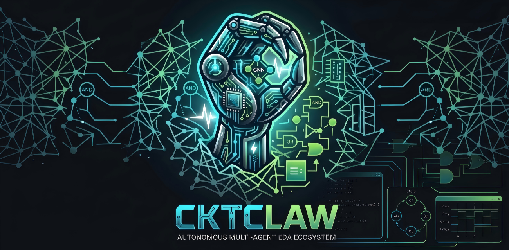

<div align="center">



# CktClaw

**The Autonomous Multi-Agent Ecosystem for Intelligent EDA**

[AlexWang](https://github.com/959AI994) · PhD Student · Shanghai Jiao Tong University · ACE Lab

[](https://www.python.org/downloads/)
[](LICENSE)
[](tests/)

[中文文档](README.md) | **English**

</div>

---

<div align="center">

## 📋 Table of Contents

</div>

<table align="center">
<tr>
<td width="33%" align="center" valign="top">

### 🚀 Getting Started
- [Overview](#-overview)
- [Key Features](#-key-features)
- [Quick Start](#-quick-start)
- [User Guide](#-user-guide)

</td>
<td width="33%" align="center" valign="top">

### 🏗️ Core Systems
- [Architecture](#️-architecture)
- [Commands](#-commands)
- [Use Cases](#-use-cases)
- [Configuration](#️-configuration)

</td>
<td width="33%" align="center" valign="top">

### 🔧 Advanced
- [Adding EDA Skills](#-adding-eda-skills)
- [API Reference](#-api-reference)
- [Contributing](#-contributing)
- [Citation](#-citation)

</td>
</tr>
</table>

---

## 🎯 Overview

**CktClaw** is an intelligent EDA ecosystem that combines circuit reverse engineering, AI-powered analysis, and automated tool orchestration. It specializes in AIG→Verilog functional recovery with advanced context management and multi-agent collaboration.

### What Makes CktClaw Special?

- 🔄 **Intelligent Context Management**: 4-layer architecture with automatic compression (150K→40K tokens)
- ⚡ **High-Performance Tool Orchestration**: Smart parallel/serial execution with dependency analysis
- 🤖 **Multi-Engine AI Support**: Local LogicRT inference + Cloud DeepSeek enhancement
- 🔧 **Extensible EDA Integration**: Easy-to-add custom EDA tools and skills
- 📊 **AI4EDA Data Pipeline**: Large-scale dataset processing with PyG/GraphML support

---

## ✨ Key Features

### 🔄 Circuit Reverse Engineering
Transform gate-level AIG files into readable, structured Verilog RTL code with AI-powered semantic recovery.

```bash
> /reverse circuit.aig
[LogicRT] Analyzing circuit structure...
[Verilog] Generated successfully
> What does this circuit do?
[Assistant] This is an 8-bit Wallace tree multiplier...
```

### 🧠 CktMem Memory System

**4-Layer Context Architecture:**
```
┌─────────────────────────────────────┐
│ System Layer                        │  ← System prompts, tool definitions
├─────────────────────────────────────┤
│ Project Layer                       │  ← Workspace state, project memory
├─────────────────────────────────────┤
│ Session Layer                       │  ← Core context, compact summaries
├─────────────────────────────────────┤
│ Turn Layer                          │  ← Recent N turns, current input
└─────────────────────────────────────┘
```

**Automatic Compression:**
- Triggers at 150,000 tokens
- Compresses to ~40,000 tokens
- Multi-strategy: Session Memory → Micro → Full → Simple Suffix
- Preserves core decisions and context

### 🔧 Harness Services

| Service | Description | Status |
|---------|-------------|--------|
| **Auto Compact** | Multi-strategy context compression | 🟢 90% |
| **Tool Orchestration** | Smart parallel/serial execution | 🟢 90% |
| **Rate Limiting** | Token bucket algorithm protection | 🟢 100% |
| **Hook System** | Pre/Post-compact & session hooks | 🟢 95% |
| **File Attachments** | Intelligent file recovery | 🟢 90% |

### 🛠️ EDA Tools Integration

- **ABC**: Advanced logic synthesis and optimization
- **Yosys**: Open-source synthesis framework
- **OpenSTA**: Static timing analysis
- **Custom Tools**: Easy integration via skill system

---

## 🚀 Quick Start

### Installation

```bash
# Clone repository
git clone git@github.com:959AI994/cktclaw.git
cd cktclaw

# Create conda environment
conda create -n aig_verilog python=3.10
conda activate aig_verilog

# Install dependencies
pip install prompt_toolkit rich torch transformers anthropic
```

### Launch CktClaw

```bash
python main.py
```

You'll see:
```
██████╗██╗  ██╗████████╗ ██████╗██╗      █████╗ ██╗    ██╗
██╔════╝██║ ██╔╝╚══██╔══╝██╔════╝██║     ██╔══██╗██║    ██║
██║     █████╔╝    ██║   ██║     ██║     ███████║██║ █╗ ██║
██║     ██╔═██╗    ██║   ██║     ██║     ██╔══██║██║███╗██║
╚██████╗██║  ██╗   ██║   ╚██████╗███████╗██║  ██║╚███╔███╔╝
 ╚═════╝╚═╝  ╚═╝   ╚═╝    ╚═════╝╚══════╝╚═╝  ╚═╚══╝╚══╝

CktClaw: The Autonomous Multi-Agent Ecosystem for Intelligent EDA
```

### First Steps

```bash
# Reverse engineer a circuit
> /reverse test/aig/adder.aig

# Ask questions about the circuit
> Explain the critical path in this design

# Launch ABC for synthesis exploration
> /abc

# Process AI4EDA datasets
> /ai4eda

# Get help
> /help
```

---

## 📖 User Guide

### Basic Commands

#### Circuit Analysis
```bash
/reverse <path>        # Convert AIG to Verilog and analyze
                       # Example: /reverse circuits/multiplier.aig
```

#### EDA Tools
```bash
/abc                   # Launch interactive ABC terminal
/yosys                 # Launch interactive Yosys terminal
/opensta               # Launch OpenSTA for timing analysis
```

#### AI4EDA Toolkit
```bash
/ai4eda                # Enter AI4EDA data processing menu
                       # - AIG → PyG conversion
                       # - GraphML generation
                       # - Batch dataset processing
```

#### Model & Engine Management
```bash
/model                 # Interactive model selection menu
/engine <name>         # Switch analysis engine
                       # Options: logicrt (local), deepseek (cloud)
```

#### Session Management
```bash
/clear                 # Start a new session
/session info          # Show current session details
/sessions list         # List all recent sessions
```

### Workflow Examples

#### Example 1: Circuit Reverse Engineering

```bash
# Step 1: Load and analyze circuit
> /reverse circuits/alu.aig
[LogicRT] Loading AIG file...
[LogicRT] Analyzing circuit structure...
[Verilog] Generated: alu.v

# Step 2: Ask questions
> What is the function of this circuit?
[Assistant] This is an Arithmetic Logic Unit (ALU) that supports...

# Step 3: Explore optimizations
> Can you suggest optimizations for area?
[Assistant] Based on the analysis, you can...

# Step 4: Synthesize with ABC
> /abc
abc> read_aiger circuits/alu.aig
abc> strash; balance; rewrite
abc> print_stats
```

#### Example 2: Long Conversation with Auto-Compression

```bash
> /reverse circuit1.aig
> Analyze the timing characteristics
> What about power consumption?
> Compare with circuit2.aig
... (continue conversation)

# When tokens exceed 150K, auto-compression triggers:
[INFO] Token count: 155000 > threshold: 150000
[INFO] Triggering auto-compact...
[Compact] Strategy: Session Memory Compact
[Compact] Pre-compact tokens: 155000
[Compact] Post-compact tokens: 42000
💾 Compacted conversation, saved ~113,000 tokens

# Conversation continues seamlessly
> Continue the analysis...
```

#### Example 3: Batch Processing with AI4EDA

```bash
> /ai4eda
╔══════════════════════════════════════╗
║       AI4EDA Toolkit Menu            ║
╠══════════════════════════════════════╣
║ 1. AIG → PyG Batch Conversion        ║
║ 2. GraphML Generation                ║
║ 3. Dataset Cleaning                  ║
║ 4. Feature Extraction                ║
║ 5. Back to Main Menu                 ║
╚══════════════════════════════════════╝

> 1
[Input] Enter source directory: ./datasets/aig_files
[Input] Enter output directory: ./datasets/pyg_data
[Batch] Processing 1000 AIG files...
[Progress] ████████████████████ 100% (1000/1000)
[Success] Converted 1000 files in 45.2s
```

### Understanding Auto-Compression

CktClaw automatically manages context to prevent token overflow:

**When does it trigger?**
- Token count exceeds 150,000
- Configurable threshold in `cktmem/models.py`

**Compression Strategies:**

1. **Session Memory Compact** (Lightest)
   - Keeps suffix messages
   - No LLM summary needed
   - Best for preserving 80%+ of conversation

2. **Micro Compact** (Medium)
   - Cleans tool results
   - Removes image/document blocks
   - No LLM call required

3. **Full Compact** (Heaviest)
   - LLM generates summary
   - Maximum compression ratio
   - Preserves core decisions

4. **Simple Suffix** (Fallback)
   - Keeps recent messages
   - Always available

**What's preserved?**
- Core circuit analysis results
- Important decisions and conclusions
- Recently accessed files (up to 5)
- User preferences and context

---

## 🔌 Adding EDA Skills

CktClaw makes it easy to integrate new EDA tools as "skills". Here's how:

### Step 1: Create Tool Runner

Create a new file in `eda_tools/`:

```python
# eda_tools/my_tool_runner.py

import subprocess
from typing import Optional

class MyToolRunner:
    """Runner for MyTool EDA software"""

    def __init__(self, tool_path: str = "mytool"):
        self.tool_path = tool_path

    def run_command(self, command: str) -> str:
        """Execute MyTool command and return output"""
        try:
            result = subprocess.run(
                [self.tool_path, "-c", command],
                capture_output=True,
                text=True,
                timeout=30
            )
            return result.stdout
        except Exception as e:
            return f"Error: {str(e)}"

    def interactive_mode(self):
        """Launch interactive MyTool terminal"""
        subprocess.run([self.tool_path, "-i"])
```

### Step 2: Create Command Handler

Create a handler in `handlers/`:

```python
# handlers/mytool_handler.py

from eda_tools.my_tool_runner import MyToolRunner
from ui.renderer import console

class MyToolHandler:
    """Handler for /mytool command"""

    def __init__(self):
        self.runner = MyToolRunner()

    async def handle(self, args: str = ""):
        """Handle /mytool command"""
        console.print("[bold cyan]Launching MyTool...[/bold cyan]")

        if args:
            # Execute command directly
            output = self.runner.run_command(args)
            console.print(output)
        else:
            # Launch interactive mode
            self.runner.interactive_mode()
```

### Step 3: Register Command

Add to `main.py`:

```python
# main.py

from handlers.mytool_handler import MyToolHandler

# In the command processing section:
elif user_input.startswith('/mytool'):
    args = user_input[8:].strip()
    mytool_handler = MyToolHandler()
    await mytool_handler.handle(args)
```

### Step 4: Add to Help System

Update `handlers/help_handler.py`:

```python
# handlers/help_handler.py

COMMANDS = {
    # ... existing commands ...
    "/mytool": "Launch MyTool EDA software",
    "/mytool <cmd>": "Execute MyTool command directly",
}
```

### Step 5: (Optional) Add AI Integration

To enable AI-powered analysis with your tool:

```python
# handlers/mytool_handler.py

async def analyze_with_ai(self, circuit_file: str):
    """Analyze circuit using MyTool + AI"""

    # Run tool analysis
    output = self.runner.run_command(f"analyze {circuit_file}")

    # Send to AI for interpretation
    prompt = f"""
    MyTool analysis output:
    {output}

    Please explain the results in plain language.
    """

    # Use chat handler to get AI response
    from handlers.chat_handler_v2 import process_chat_v2
    response = await process_chat_v2(prompt, session_id)

    return response
```

### Complete Example: Adding Cadence Genus

```python
# eda_tools/genus_runner.py
class GenusRunner:
    def __init__(self, genus_path: str = "genus"):
        self.genus_path = genus_path

    def synthesize(self, rtl_file: str, constraints: str) -> dict:
        """Run synthesis and return metrics"""
        script = f"""
        read_hdl {rtl_file}
        read_sdc {constraints}
        syn_generic
        syn_map
        syn_opt
        report_area
        report_timing
        """
        output = self.run_script(script)
        return self.parse_metrics(output)

# handlers/genus_handler.py
class GenusHandler:
    async def handle(self, args: str):
        if args.startswith("synth"):
            # Parse: /genus synth design.v constraints.sdc
            _, rtl, sdc = args.split()
            metrics = self.runner.synthesize(rtl, sdc)

            # Display results
            console.print(f"[green]Area: {metrics['area']} um²[/green]")
            console.print(f"[yellow]Delay: {metrics['delay']} ns[/yellow]")
```

---

## 🏗️ Architecture

### Project Structure

```
cktclaw/
├── main.py                          # Main REPL loop
├── config.py                        # Configuration
│
├── cktmem/                          # Memory Management System
│   ├── manager.py                   # Context manager (4-layer)
│   ├── compactor.py                 # Compression engine
│   ├── storage.py                   # SQLite persistence
│   ├── token_counter.py             # Token estimation
│   └── models.py                    # Data models
│
├── harness/                         # Harness Services (95% complete)
│   ├── services/
│   │   ├── compact/
│   │   │   ├── auto_compact.py      # Multi-strategy compression
│   │   │   ├── micro_compact.py     # Image/tool result cleaning
│   │   │   └── attachments.py       # File recovery system
│   │   ├── tools/
│   │   │   └── tool_orchestration.py # Parallel/serial execution
│   │   └── api/
│   │       └── rate_limiter.py      # Token bucket rate limiting
│   ├── hooks/
│   │   ├── pre_compact.py           # Pre-compression hooks
│   │   ├── post_compact.py          # Post-compression hooks
│   │   └── session_start.py         # Session initialization hooks
│   └── query/
│       └── query_loop_enhanced.py   # Enhanced query loop
│
├── handlers/                        # Command Handlers
│   ├── chat_handler_v2.py           # Chat with rate limiting
│   ├── reverse_handler.py           # AIG→Verilog reverse engineering
│   ├── abc_handler.py               # ABC integration
│   ├── yosys_handler.py             # Yosys integration
│   ├── ai4eda_handler.py            # AI4EDA toolkit
│   ├── model_handler.py             # Model selection
│   ├── engine_handler.py            # Engine switching
│   ├── session_handler.py           # Session management
│   └── help_handler.py              # Help system
│
├── eda_tools/                       # EDA Tool Runners
│   ├── abc_runner.py                # ABC wrapper
│   ├── yosys_runner.py              # Yosys wrapper
│   └── tool_dicts.py                # Tool configurations
│
└── ui/                              # User Interface
    ├── colors.py                    # Color schemes
    └── renderer.py                  # Rich terminal components
```

### Data Flow

```
User Input
    ↓
ContextManager.build_context()
    ├─ Load System Layer (prompts, tools)
    ├─ Load Project Layer (workspace state)
    ├─ Load Session Layer (core context, summaries)
    └─ Load Turn Layer (recent N turns)
    ↓
Token Estimation (>150K?)
    ↓ YES
Compactor.auto_compact()
    ├─ Execute Pre-Compact Hooks
    ├─ Select Strategy (Session Memory → Micro → Full)
    ├─ Perform Compression
    ├─ Recover File Attachments
    └─ Execute Post-Compact Hooks
    ↓
RateLimiter.acquire()
    ├─ Check request/token limits
    └─ Wait if necessary
    ↓
LLM Call (LogicRT/DeepSeek)
    ↓
Tool Orchestration (if tool calls)
    ├─ Partition into batches
    ├─ Execute parallel tools concurrently
    ├─ Execute serial tools sequentially
    └─ Apply Context Modifiers
    ↓
Store Response → SQLite
    ↓
Display to User
```

---

## ⚙️ Configuration

### Compression Settings

Edit `cktmem/models.py`:

```python
@dataclass
class CompactConfig:
    auto_compact_threshold: int = 150_000  # Trigger threshold
    target_tokens: int = 40_000            # Target after compression
    buffer_tokens: int = 13_000            # Safety buffer
```

### Rate Limiting

Edit `handlers/chat_handler_v2.py`:

```python
config = RateLimitConfig(
    max_requests_per_minute=60,       # Max 60 requests/min
    max_tokens_per_minute=100_000,    # Max 100K tokens/min
    max_concurrent_requests=10,       # Max 10 concurrent
)
```

### File Attachment Recovery

Edit `harness/services/compact/attachments.py`:

```python
POST_COMPACT_MAX_FILES_TO_RESTORE = 5      # Max 5 files
POST_COMPACT_TOKEN_BUDGET = 50_000         # 50K token budget
POST_COMPACT_MAX_TOKENS_PER_FILE = 5_000   # 5K per file
```

### Custom Hooks

Register custom hooks for compression events:

```python
# my_hooks.py
from harness.hooks.pre_compact import PreCompactHook, register_pre_compact_hook

class MyCustomHook(PreCompactHook):
    def __init__(self):
        super().__init__("my_hook", priority=50)

    async def execute(self, hook_input, abort_signal=None):
        # Custom logic before compression
        print(f"About to compress {hook_input.pre_compact_tokens} tokens")

        return PreCompactHookResult(
            new_custom_instructions="Keep all technical details",
            user_display_message="Custom pre-processing..."
        )

# Register the hook
register_pre_compact_hook(MyCustomHook())
```

---

## 📚 API Reference

### CktMem API

```python
from cktmem import ContextManager, Storage, CompactConfig

# Initialize
storage = Storage("sessions.db")
config = CompactConfig(auto_compact_threshold=150_000)
manager = ContextManager(storage, system_prompt, config)

# Build context with auto-compression
messages = await manager.build_context(
    session_id="session_123",
    user_message="Analyze this circuit",
    auto_compact=True
)

# Manual compression
from cktmem.compactor import Compactor
compactor = Compactor(storage, config)
result = await compactor.manual_compact(
    session_id="session_123",
    custom_instructions="Keep technical details"
)
```

### Harness Services API

```python
# Tool Orchestration
from harness.services.tools import run_tools, MessageUpdate

tool_calls = [
    {"id": "1", "name": "Read", "input": {"file_path": "test.v"}},
    {"id": "2", "name": "Grep", "input": {"pattern": "module"}},
]

async for update in run_tools(tool_calls, executor, context):
    if update.message:
        print(update.message)

# Rate Limiting
from harness.services.api import RateLimiter, RateLimitConfig

limiter = RateLimiter(RateLimitConfig())
can_proceed = await limiter.acquire(estimated_tokens=5000)

# Hooks
from harness.hooks import execute_pre_compact_hooks, PreCompactHookInput

hook_input = PreCompactHookInput(trigger="auto")
result = await execute_pre_compact_hooks(hook_input)
```

---

## 🤝 Contributing

Contributions are welcome! Please feel free to submit issues or pull requests.

---

## 📄 License

MIT License

---

## 📖 Citation

If you use CktClaw in your research, please cite:

```bibtex
@software{cktclaw2024,
  author = {Wang, Jingxin},
  title = {CktClaw: The Autonomous Multi-Agent Ecosystem for Intelligent EDA},
  year = {2024},
  institution = {Shanghai Jiao Tong University},
  url = {https://github.com/959AI994/cktclaw}
}
```

---

## 📧 Contact

- **Author**: AlexWang
- **Institution**: Shanghai Jiao Tong University
- **Lab**: ACE Lab
- **GitHub**: [@959AI994](https://github.com/959AI994)

---

<div align="center">

**CktClaw** - Making Circuit Analysis Smarter

⭐ Star us on GitHub if this project helps you!

[Report Bug](https://github.com/959AI994/cktclaw/issues) · [Request Feature](https://github.com/959AI994/cktclaw/issues) · [Documentation](https://github.com/959AI994/cktclaw/wiki)

</div>
