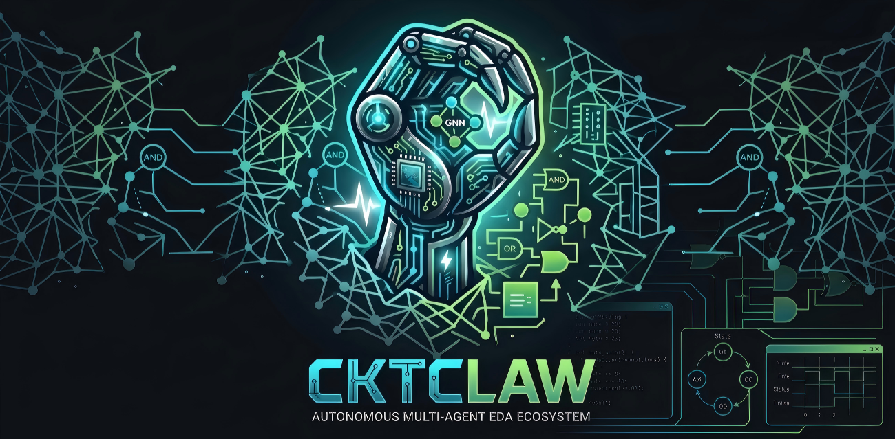

<div align="center">



# CktClaw

**面向智能 EDA 的多智能体自主生态 · The Autonomous Multi-Agent Ecosystem for Intelligent EDA**

[AlexWang](https://github.com/959AI994) · PhD Student · Shanghai Jiao Tong University · ACE Lab

[](https://www.python.org/downloads/)
[](LICENSE)
[](tests/)

**中文** | [English](README-EN.md)

</div>

---

<div align="center">

## 📋 目录

</div>

<table align="center">
<tr>
<td width="33%" align="center" valign="top">

### 🚀 快速入门
- [核心能力](#-核心能力--key-capabilities)
- [功能特性](#-功能特性--features)
- [快速开始](#-快速开始--quick-start)
- [用户指南](#-用户指南--user-guide)

</td>
<td width="33%" align="center" valign="top">

### 🏗️ 核心系统
- [架构设计](#-架构设计--architecture)
- [命令参考](#-命令参考--commands)
- [使用案例](#-使用案例--use-cases)
- [配置说明](#-配置说明--configuration)

</td>
<td width="33%" align="center" valign="top">

### 🔧 进阶开发
- [添加 EDA 技能](#-添加-eda-技能)
- [API 参考](#-api-参考)
- [贡献指南](#-贡献--contributing)
- [引用](#-引用--citation)

</td>
</tr>
</table>

---

## 🎯 核心能力 · Key Capabilities

### 1. 电路逆向工程 · Circuit Reverse Engineering
- **AIG→Verilog 语义恢复**：将门级抽象还原为结构化 RTL，支持复杂控制/数据通路重建
- **模式识别与净化**：基于图神经网络的电路结构分析与优化
- **多引擎支持**：LogicRT 本地推理 + DeepSeek 云端增强

### 2. 智能上下文管理 · Intelligent Context Management
- **四层上下文架构**：System / Project / Session / Turn 层级隔离
- **自动压缩策略**：Token 超过 150K 自动触发，支持 Session Memory / Micro / Full 多策略
- **边界隔离机制**：防止语义混淆，保留核心决策历史

### 3. 高性能工具编排 · High-Performance Tool Orchestration
- **智能并行/串行执行**：自动分析工具依赖关系，最大化执行效率
- **Context Modifier 机制**：正确处理并行工具的上下文修改
- **速率限制保护**：Token Bucket 算法防止 API 过载

### 4. AI4EDA 数据工具链 · AI4EDA Data Tooling
- **GraphML/PyG 转换**：支持大规模数据集的高吞吐转换与清洗
- **向量化表征**：结合大模型实现可解释电路理解
- **跨版本兼容**：覆盖 PyG 多版本兼容性与稳健 I/O

### 5. 硬件度量与综合 · Hardware Metrics & Synthesis
- **集成 ABC/Yosys**：自动化优化序列探索
- **ASAP7 库支持**：面积/时延精确估计
- **静态时序分析**：OpenSTA 集成

### 6. 学术创新工作流 · Academic Innovation Workflows
- **RLTF (Reinforcement Learning from Tool Feedback)**：基于工具反馈的强化学习综合序列优化
- **Pareto Multi-Agent Negotiation**：驱动帕累托最优 PPA 的博弈论多智能体协商协议
- **自主综合配方**：基于 ASAP7 的面积/时延估计，驱动 ABC/Yosys 的自主演化优化序列

---

## ✨ 功能特性 · Features

### 🖥️ 交互式 CLI 界面 · Interactive CLI
- 现代化 REPL 体验，支持命令历史和自动补全
- Rich 终端 UI，语法高亮和进度指示
- SQLite 会话持久化

### 🧠 CktMem 记忆系统 · CktMem Memory System
- **四层上下文模型**：
  - **System Layer**: 系统 Prompt、工具定义、全局规则
  - **Project Layer**: 工作区状态、项目级 Memory
  - **Session Layer**: 核心上下文、压缩摘要
  - **Turn Layer**: 最近 N 轮对话、当前输入

- **自动压缩触发**：
  - Token 阈值：150,000 tokens
  - 压缩目标：40,000 tokens
  - 策略选择：Session Memory → Micro → Full → Simple Suffix

- **压缩边界标记**：
  ```
  ━━━ COMPACT BOUNDARY ━━━
  Previous conversation has been summarized.
  Pre-compact tokens: 150000
  Post-compact tokens: 42000
  Tokens saved: 108000
  ```

### 🔧 Harness Services

#### 1. Auto Compact - 自动压缩
- **Session Memory Compact**: 保留后缀消息，最轻量
- **Micro Compact**: 清理工具结果、图片/文档块
- **Full Compact**: LLM 总结，最大压缩率
- **Simple Suffix**: 兜底策略，始终可用

#### 2. Tool Orchestration - 工具编排
- **智能分批执行**: 自动分析依赖关系
- **并行执行**: 独立工具并发运行
- **串行执行**: 依赖工具顺序执行
- **Context Modifier**: 正确处理上下文修改

#### 3. Rate Limiting - 速率限制
- **Token Bucket 算法**: 每分钟 60 请求 / 100K tokens
- **自动等待重试**: 超限自动等待并重试
- **并发控制**: 最多 10 个并发请求

#### 4. Hook System - 钩子系统
- **Pre-Compact Hooks**: 压缩前修改行为
- **Post-Compact Hooks**: 压缩后处理结果
- **Session Start Hooks**: 会话启动初始化
- **可扩展注册**: 支持自定义钩子

#### 5. File Attachment Recovery - 文件附件恢复
- **智能文件选择**: 按时间戳排序，最近优先
- **Token 预算管理**: 限制文件数量和大小
- **自动去重**: 排除已在保留消息中的文件

### 🛠️ EDA 工具集成 · EDA Tools Integration
- **ABC**: 高级逻辑综合与优化
- **Yosys**: 开源综合框架
- **OpenSTA**: 静态时序分析
- 所有工具支持交互式终端

### 🤖 多引擎支持 · Multi-Engine Support
- **LogicRT**: 本地推理引擎（默认）
- **DeepSeek**: 云端 API 增强分析
- 运行时动态切换
- **Provider 架构**：BaseLLMProvider 抽象接口，支持热插拔新引擎

### 🔬 学术创新工作流 · Innovation Workflows
- **RLTF**: 基于工具反馈的强化学习综合序列（`/rltf`）
- **Pareto Negotiation**: 多智能体博弈论协商优化 PPA（`/pareto`）
- 通过 SkillRegistry 注册，完全解耦于核心系统

---

## 🚀 快速开始 · Quick Start

### 安装 · Installation

```bash
# 克隆仓库
git clone git@github.com:959AI994/cktclaw.git
cd cktclaw

# 创建 Conda 环境
conda create -n aig_verilog python=3.10
conda activate aig_verilog

# 安装依赖
pip install prompt_toolkit rich torch transformers anthropic
```

### 启动 · Launch

```bash
python main.py
```

欢迎界面：
```
██████╗██╗  ██╗████████╗ ██████╗██╗      █████╗ ██╗    ██╗
██╔════╝██║ ██╔╝╚══██╔══╝██╔════╝██║     ██╔══██╗██║    ██║
██║     █████╔╝    ██║   ██║     ██║     ███████║██║ █╗ ██║
██║     ██╔═██╗    ██║   ██║     ██║     ██╔══██║██║███╗██║
╚██████╗██║  ██╗   ██║   ╚██████╗███████╗██║  ██║╚███╔███╔╝
 ╚═════╝╚═╝  ╚═╝   ╚═╝    ╚═════╝╚══════╝╚═╝  ╚═╚══╝╚══╝

CktClaw: The Autonomous Multi-Agent Ecosystem for Intelligent EDA
```

### 基本使用 · Basic Usage

```bash
# 电路逆向工程
> /reverse test/aig/adder.aig

# 启动 ABC 工具
> /abc

# 进入 AI4EDA 工具包
> /ai4eda

# 切换模型引擎
> /model

# 查看会话信息
> /session info

# 帮助
> /help
```

---

## 📖 用户指南 · User Guide

### 基础命令详解

#### 电路分析命令
```bash
/reverse <路径>        # 将 AIG 转换为 Verilog 并分析
                       # 示例: /reverse circuits/multiplier.aig
```

#### EDA 工具命令
```bash
/abc                   # 启动 ABC 交互式终端
/yosys                 # 启动 Yosys 交互式终端
/opensta               # 启动 OpenSTA 进行时序分析
```

#### AI4EDA 工具包
```bash
/ai4eda                # 进入 AI4EDA 数据处理菜单
                       # - AIG → PyG 转换
                       # - GraphML 生成
                       # - 批量数据集处理
```

#### 模型与引擎管理
```bash
/model                 # 交互式模型选择菜单
/engine <名称>         # 切换分析引擎
                       # 选项: logicrt (本地), deepseek (云端)
```

#### 会话管理
```bash
/clear                 # 开始新会话
/session info          # 显示当前会话详情
/sessions list         # 列出所有最近会话
```

### 工作流示例

#### 示例 1: 电路逆向工程完整流程

```bash
# 步骤 1: 加载并分析电路
> /reverse circuits/alu.aig
[LogicRT] 正在加载 AIG 文件...
[LogicRT] 正在分析电路结构...
[Verilog] 已生成: alu.v

# 步骤 2: 提问
> 这个电路实现什么功能？
[Assistant] 这是一个算术逻辑单元 (ALU)，支持...

# 步骤 3: 探索优化
> 能否建议面积优化方案？
[Assistant] 根据分析，您可以...

# 步骤 4: 使用 ABC 综合
> /abc
abc> read_aiger circuits/alu.aig
abc> strash; balance; rewrite
abc> print_stats
```

#### 示例 2: 长对话自动压缩

```bash
> /reverse circuit1.aig
> 分析时序特性
> 功耗如何？
> 与 circuit2.aig 对比
... (继续对话)

# 当 token 超过 150K 时，自动压缩触发：
[INFO] Token count: 155000 > threshold: 150000
[INFO] Triggering auto-compact...
[Compact] Strategy: Session Memory Compact
[Compact] Pre-compact tokens: 155000
[Compact] Post-compact tokens: 42000
💾 Compacted conversation, saved ~113,000 tokens

# 对话无缝继续
> 继续分析...
```

#### 示例 3: AI4EDA 批量处理

```bash
> /ai4eda
╔══════════════════════════════════════╗
║       AI4EDA 工具包菜单              ║
╠══════════════════════════════════════╣
║ 1. AIG → PyG 批量转换                ║
║ 2. GraphML 生成                      ║
║ 3. 数据集清洗                        ║
║ 4. 特征提取                          ║
║ 5. 返回主菜单                        ║
╚══════════════════════════════════════╝

> 1
[输入] 源目录: ./datasets/aig_files
[输入] 输出目录: ./datasets/pyg_data
[批处理] 正在处理 1000 个 AIG 文件...
[进度] ████████████████████ 100% (1000/1000)
[成功] 在 45.2 秒内转换了 1000 个文件
```

### 理解自动压缩机制

CktClaw 自动管理上下文以防止 token 溢出：

**何时触发？**
- Token 数量超过 150,000
- 可在 `cktmem/models.py` 中配置阈值

**压缩策略：**

1. **Session Memory Compact**（最轻量）
   - 保留后缀消息
   - 无需 LLM 摘要
   - 适合保留 80%+ 对话内容

2. **Micro Compact**（中等）
   - 清理工具结果
   - 移除图片/文档块
   - 无需调用 LLM

3. **Full Compact**（最重）
   - LLM 生成摘要
   - 最大压缩率
   - 保留核心决策

4. **Simple Suffix**（兜底）
   - 保留最近消息
   - 始终可用

**保留什么？**
- 核心电路分析结果
- 重要决策和结论
- 最近访问的文件（最多 5 个）
- 用户偏好和上下文

---

## 🔌 添加 EDA 技能

CktClaw 让集成新的 EDA 工具变得简单。以下是完整步骤：

### 步骤 1: 创建工具运行器

在 `eda_tools/` 中创建新文件：

```python
# eda_tools/my_tool_runner.py

import subprocess
from typing import Optional

class MyToolRunner:
    """MyTool EDA 软件运行器"""

    def __init__(self, tool_path: str = "mytool"):
        self.tool_path = tool_path

    def run_command(self, command: str) -> str:
        """执行 MyTool 命令并返回输出"""
        try:
            result = subprocess.run(
                [self.tool_path, "-c", command],
                capture_output=True,
                text=True,
                timeout=30
            )
            return result.stdout
        except Exception as e:
            return f"错误: {str(e)}"

    def interactive_mode(self):
        """启动交互式 MyTool 终端"""
        subprocess.run([self.tool_path, "-i"])
```

### 步骤 2: 创建命令处理器

在 `handlers/` 中创建处理器：

```python
# handlers/mytool_handler.py

from eda_tools.my_tool_runner import MyToolRunner
from ui.renderer import console

class MyToolHandler:
    """处理 /mytool 命令"""

    def __init__(self):
        self.runner = MyToolRunner()

    async def handle(self, args: str = ""):
        """处理 /mytool 命令"""
        console.print("[bold cyan]正在启动 MyTool...[/bold cyan]")

        if args:
            # 直接执行命令
            output = self.runner.run_command(args)
            console.print(output)
        else:
            # 启动交互模式
            self.runner.interactive_mode()
```

### 步骤 3: 注册命令

在 `main.py` 中添加：

```python
# main.py

from handlers.mytool_handler import MyToolHandler

# 在命令处理部分：
elif user_input.startswith('/mytool'):
    args = user_input[8:].strip()
    mytool_handler = MyToolHandler()
    await mytool_handler.handle(args)
```

### 步骤 4: 添加到帮助系统

更新 `handlers/help_handler.py`：

```python
# handlers/help_handler.py

COMMANDS = {
    # ... 现有命令 ...
    "/mytool": "启动 MyTool EDA 软件",
    "/mytool <cmd>": "直接执行 MyTool 命令",
}
```

### 步骤 5: （可选）添加 AI 集成

为工具启用 AI 驱动的分析：

```python
# handlers/mytool_handler.py

async def analyze_with_ai(self, circuit_file: str):
    """使用 MyTool + AI 分析电路"""

    # 运行工具分析
    output = self.runner.run_command(f"analyze {circuit_file}")

    # 发送给 AI 进行解释
    prompt = f"""
    MyTool 分析输出:
    {output}

    请用通俗语言解释结果。
    """

    # 使用聊天处理器获取 AI 响应
    from handlers.chat_handler_v2 import process_chat_v2
    response = await process_chat_v2(prompt, session_id)

    return response
```

### 完整示例: 添加 Cadence Genus

```python
# eda_tools/genus_runner.py
class GenusRunner:
    def __init__(self, genus_path: str = "genus"):
        self.genus_path = genus_path

    def synthesize(self, rtl_file: str, constraints: str) -> dict:
        """运行综合并返回指标"""
        script = f"""
        read_hdl {rtl_file}
        read_sdc {constraints}
        syn_generic
        syn_map
        syn_opt
        report_area
        report_timing
        """
        output = self.run_script(script)
        return self.parse_metrics(output)

# handlers/genus_handler.py
class GenusHandler:
    async def handle(self, args: str):
        if args.startswith("synth"):
            # 解析: /genus synth design.v constraints.sdc
            _, rtl, sdc = args.split()
            metrics = self.runner.synthesize(rtl, sdc)

            # 显示结果
            console.print(f"[green]面积: {metrics['area']} um²[/green]")
            console.print(f"[yellow]延迟: {metrics['delay']} ns[/yellow]")
```

### 高级技巧

#### 1. 添加进度条

```python
from rich.progress import Progress

with Progress() as progress:
    task = progress.add_task("[cyan]处理中...", total=100)
    for i in range(100):
        # 执行工作
        progress.update(task, advance=1)
```

#### 2. 添加配置文件支持

```python
# config/mytool_config.py
MYTOOL_CONFIG = {
    "path": "/usr/local/bin/mytool",
    "timeout": 60,
    "max_retries": 3,
}
```

#### 3. 添加错误处理

```python
from typing import Optional, Tuple

def run_with_retry(self, command: str, max_retries: int = 3) -> Tuple[bool, str]:
    """带重试的命令执行"""
    for attempt in range(max_retries):
        try:
            result = self.run_command(command)
            return True, result
        except Exception as e:
            if attempt == max_retries - 1:
                return False, f"失败: {str(e)}"
            time.sleep(1)
```

---

## 🏗️ 架构设计 · Architecture

### 核心架构改进（2026-04-12）

**Provider 架构重构** - 将原 1039 行的 God Object 解耦为清晰的分层架构：

```
┌─────────────────────────────────────────────────────────────┐
│  LLMVerilogAnalyzer (Facade - 133 lines)                    │
│  ├─ 路由请求到对应 Provider                                  │
│  └─ 保持向后兼容的公共 API                                   │
└─────────────────────────────────────────────────────────────┘
                          ↓
        ┌─────────────────┴─────────────────┐
        ↓                                   ↓
┌──────────────────────┐      ┌──────────────────────────┐
│ DeepSeekProvider     │      │ LocalCodeVProvider       │
│ (206 lines)          │      │ (362 lines)              │
├──────────────────────┤      ├──────────────────────────┤
│ • HTTP API 通信      │      │ • PyTorch 模型加载       │
│ • 原生工具调用解析   │      │ • GPU 内存扫描与选择     │
│ • 速率限制处理       │      │ • 懒加载策略             │
│ • 错误重试机制       │      │ • 多策略工具调用解析     │
└──────────────────────┘      └──────────────────────────┘
                          ↓
        ┌─────────────────┴─────────────────┐
        ↓                                   ↓
┌──────────────────────┐      ┌──────────────────────────┐
│ VerilogMetricsExtractor│    │ ToolCallParser           │
│ (107 lines)          │      │ (228 lines)              │
├──────────────────────┤      ├──────────────────────────┤
│ • 度量提取（正则）   │      │ • 7 层降级解析策略       │
│ • 分析提示生成       │      │ • JSON/ChatML/正则       │
│ • 降级分析           │      │ • 弱模型容错             │
└──────────────────────┘      └──────────────────────────┘
```

**架构优势**：
- ✅ **单一职责**：每个类只负责一个明确的功能
- ✅ **开闭原则**：易于添加新 Provider（OpenAI、Gemini 等）
- ✅ **依赖注入**：配置和凭证通过构造函数注入
- ✅ **可测试性**：每个组件可独立测试
- ✅ **安全性**：API 密钥移至环境变量
- ✅ **可扩展性**：新增 LLM 提供商无需修改现有代码

### 项目结构 · Project Structure

```
cktclaw/
├── main.py                          # REPL 主循环
├── config.py                        # 配置设置（含系统提示词）
│
├── models/                          # LLM 模型层（Provider 架构）
│   ├── llm_analyzer.py              # 薄门面层（133 行，原 1039 行）
│   ├── providers/
│   │   ├── base.py                  # BaseLLMProvider 抽象接口
│   │   ├── deepseek_provider.py     # DeepSeek 云端 API 通信
│   │   └── local_codev_provider.py  # 本地 GPU 推理 + 懒加载
│   └── logicrt_inferencer.py        # LogicRT 逆向推理引擎
│
├── utils/                           # 独立工具模块
│   ├── verilog_parser.py            # Verilog 度量提取与分析
│   ├── tool_call_parser.py          # 多策略工具调用解析器
│   ├── aig_converter.py             # AIG 格式转换
│   └── verilog_validator.py         # Verilog 语法验证
│
├── cktmem/                          # 记忆管理系统
│   ├── manager.py                   # 上下文管理器
│   ├── compactor.py                 # 压缩器
│   ├── storage.py                   # SQLite 存储层
│   ├── token_counter.py             # Token 计数器
│   └── models.py                    # 数据模型
├── harness/                         # Harness Services
│   ├── services/
│   │   ├── compact/                 # 压缩服务
│   │   │   ├── auto_compact.py      # 自动压缩
│   │   │   ├── micro_compact.py     # 微压缩
│   │   │   └── attachments.py       # 文件附件恢复
│   │   ├── tools/                   # 工具服务
│   │   │   └── tool_orchestration.py # 工具编排
│   │   └── api/                     # API 服务
│   │       └── rate_limiter.py      # 速率限制
│   ├── hooks/                       # 钩子系统
│   │   ├── pre_compact.py           # 压缩前钩子
│   │   ├── post_compact.py          # 压缩后钩子
│   │   └── session_start.py         # 会话启动钩子
│   └── query/                       # 查询循环
│       └── query_loop_enhanced.py   # 增强查询循环
├── handlers/                        # 命令处理器
│   ├── chat_handler_v2.py           # 对话处理（集成速率限制）
│   ├── reverse_handler.py           # 逆向工程
│   ├── abc_handler.py               # ABC 集成
│   ├── yosys_handler.py             # Yosys 集成
│   ├── ai4eda_handler.py            # AI4EDA 工具包
│   └── session_handler.py           # 会话管理
├── eda_tools/                       # EDA 工具运行器
│   ├── abc_runner.py                # ABC 包装器
│   └── yosys_runner.py              # Yosys 包装器
└── ui/                              # 用户界面
    ├── colors.py                    # 颜色方案
    └── renderer.py                  # Rich 组件
```

### 数据流 · Data Flow

```
用户输入 → ContextManager.build_context()
    ↓
四层上下文组装 (System/Project/Session/Turn)
    ↓
Token 估算 → 超过 150K？
    ↓ 是
Compactor.auto_compact()
    ├─ Pre-Compact Hooks
    ├─ 策略选择 (Session Memory → Micro → Full)
    ├─ 压缩执行
    ├─ 文件附件恢复
    └─ Post-Compact Hooks
    ↓
RateLimiter.acquire() → 速率检查
    ↓
LLMVerilogAnalyzer (Facade)
    ├─ model_choice == "deepseek" → DeepSeekProvider
    │   └─ HTTP API → DeepSeek Cloud
    └─ model_choice == "local"   → LocalCodeVProvider
        └─ GPU 推理 → 本地 CodeV 模型
    ↓
工具编排 (Tool Orchestration)
    ├─ SkillRegistry 动态注入工具列表
    ├─ ToolCallParser 解析工具调用
    ├─ 并行执行独立工具
    └─ 串行执行依赖工具
    ↓
响应存储 → SQLite
```

---

## 📚 命令参考 · Commands

### 电路逆向 · Circuit Reverse
```bash
/reverse <path>        # AIG→Verilog 转换与分析
```

### EDA 工具 · EDA Tools
```bash
/abc                   # 启动 ABC 交互终端
/yosys                 # 启动 Yosys 交互终端
/opensta               # 启动 OpenSTA 交互终端
```

### AI4EDA 工具包 · AI4EDA Toolkit
```bash
/ai4eda                # 进入数据处理工具包
```

### 模型管理 · Model Management
```bash
/model                 # 交互式模型选择
/engine <name>         # 切换分析引擎
```

### 学术工作流 · Innovation Workflows
```bash
/rltf [aig] [max_iter]           # RLTF 强化学习综合序列优化
/pareto-negotiate [aig] [rounds] # Pareto 多智能体协商优化 PPA
/pareto [aig] [rounds]           # 同 /pareto-negotiate（别名）
```

### 会话管理 · Session Management
```bash
/clear                 # 开始新会话
/session info          # 显示当前会话详情
/sessions list         # 列出最近会话
```

### 帮助与退出 · Help & Exit
```bash
/help                  # 显示所有命令
Ctrl+C                 # 退出 CktClaw
```

---

## ⚙️ 配置说明 · Configuration

### 压缩配置 · Compact Configuration

编辑 `cktmem/models.py`:

```python
@dataclass
class CompactConfig:
    auto_compact_threshold: int = 150_000  # 自动压缩阈值
    target_tokens: int = 40_000            # 目标 Token 数
    buffer_tokens: int = 13_000            # 缓冲 Token 数
```

### 速率限制配置 · Rate Limit Configuration

编辑 `handlers/chat_handler_v2.py`:

```python
config = RateLimitConfig(
    max_requests_per_minute=60,       # 每分钟最多 60 请求
    max_tokens_per_minute=100_000,    # 每分钟最多 100K tokens
    max_concurrent_requests=10,       # 最多 10 个并发请求
)
```

### 文件附件配置 · File Attachment Configuration

编辑 `harness/services/compact/attachments.py`:

```python
POST_COMPACT_MAX_FILES_TO_RESTORE = 5      # 最多恢复 5 个文件
POST_COMPACT_TOKEN_BUDGET = 50_000         # Token 预算 50K
POST_COMPACT_MAX_TOKENS_PER_FILE = 5_000   # 每个文件最多 5K tokens
```

---

## 💡 使用案例 · Use Cases

### 案例 1: 电路逆向工程
```bash
> /reverse test/aig/multiplier.aig
[LogicRT] 正在分析电路...
[Verilog] 生成成功
> 这个电路实现什么功能？
[Assistant] 这是一个 8 位乘法器，采用华莱士树结构...
```

### 案例 2: 逻辑综合探索
```bash
> /abc
abc> read_aiger circuit.aig
abc> strash; balance; rewrite; refactor
abc> print_stats
```

### 案例 3: AI4EDA 数据处理
```bash
> /ai4eda
[AI4EDA Toolkit]
1. AIG → PyG 批量转换
2. GraphML 生成
3. 数据集清洗
> 1
[Batch] 处理 1000 个 AIG 文件...
```

### 案例 4: 长对话自动压缩
```bash
> 分析这个电路
> 继续分析时序特性
> 详细说明关键路径
... (多轮对话)
[INFO] Token count: 155000 > threshold: 150000
[INFO] Triggering auto-compact...
[Compact] Pre-compact tokens: 155000
[Compact] Post-compact tokens: 42000
💾 Compacted conversation, saved ~113,000 tokens
```

---

---

## 📚 API 参考

### CktMem API

```python
from cktmem import ContextManager, Storage, CompactConfig

# 初始化
storage = Storage("sessions.db")
config = CompactConfig(auto_compact_threshold=150_000)
manager = ContextManager(storage, system_prompt, config)

# 构建上下文（自动压缩）
messages = await manager.build_context(
    session_id="session_123",
    user_message="分析这个电路",
    auto_compact=True
)
```

### Harness Services API

```python
# 工具编排
from harness.services.tools import run_tools

tool_calls = [
    {"id": "1", "name": "Read", "input": {"file_path": "test.v"}},
    {"id": "2", "name": "Grep", "input": {"pattern": "module"}},
]
async for update in run_tools(tool_calls, executor, context):
    if update.message:
        print(update.message)

# 速率限制
from harness.services.api import RateLimiter, RateLimitConfig
limiter = RateLimiter(RateLimitConfig())
can_proceed = await limiter.acquire(estimated_tokens=5000)

# 自定义 Hook
from harness.hooks.pre_compact import PreCompactHook, register_pre_compact_hook
class MyHook(PreCompactHook):
    async def execute(self, hook_input, abort_signal=None):
        return PreCompactHookResult(
            new_custom_instructions="保留所有技术细节"
        )
register_pre_compact_hook(MyHook())
```

---

## 🤝 贡献 · Contributing

欢迎贡献！请随时提交 issues 或 pull requests。

---

## 📄 许可证 · License

MIT License

---

## 📖 引用 · Citation

如果您在研究中使用 CktClaw，请引用：

```bibtex
@software{cktclaw2024,
  author = {Wang, Jingxin},
  title = {CktClaw: The Autonomous Multi-Agent Ecosystem for Intelligent EDA},
  year = {2024},
  institution = {Shanghai Jiao Tong University},
  url = {https://github.com/959AI994/cktclaw}
}
```

---

## 📧 联系方式 · Contact

- **作者 · Author**: Jingxin Wang
- **机构 · Institution**: Shanghai Jiao Tong University
- **实验室 · Lab**: ACE Lab
- **GitHub**: [@959AI994](https://github.com/959AI994)

---

<div align="center">

**CktClaw** - 让电路分析更智能 · Making Circuit Analysis Smarter

⭐ 如果这个项目对您有帮助，请给我们一个 Star！

[报告问题](https://github.com/959AI994/cktclaw/issues) · [功能请求](https://github.com/959AI994/cktclaw/issues) · [English Docs](README-EN.md)

</div>
